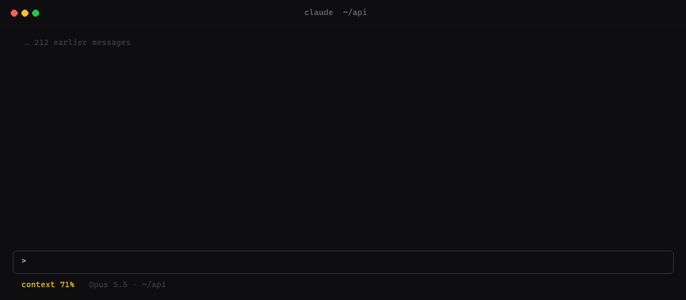
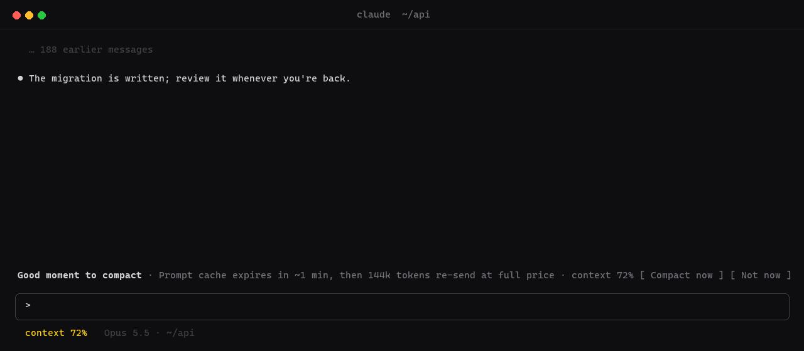

<h1 align="center">
  <picture>
    <source media="(prefers-color-scheme: light)" srcset="docs/brand/banner-light.svg">
    
  </picture>
</h1>

<p align="center">
  <a href="https://github.com/hellosverre/smart-compact/releases/latest"></a>
  <a href="LICENSE"></a>
  
</p>

<p align="center">Auto-compact waits until the context is full, and that usually lands mid-task.<br>smart-compact offers it at the right moments: when work has just landed, before the prompt cache expires,<br>or when Claude itself says it is done with what came before.</p>



## Install

Needs Claude Code **2.1.295** or later, in a terminal or the desktop app's Code tab. Run both inside Claude Code:

```
/plugin marketplace add hellosverre/smart-compact
```

```
/plugin install smart-compact@smart-compact
```

Restart Claude Code. Nothing to set up: smart-compact stays out of the way until the context is 40% full.

## Update

```bash
claude plugin marketplace update smart-compact
```

```bash
claude plugin update smart-compact@smart-compact
```

## Uninstall

```bash
claude plugin uninstall smart-compact@smart-compact
```

## When it speaks up

| Moment | The offer reads | Why then |
|---|---|---|
| Claude calls `request_compact` | **Claude wants to compact** · its reason | Claude knows when a task is finished better than a token counter does |
| A `git commit` lands | **Good moment to compact** · You just committed | The work is saved; the turns that led to it are rarely needed verbatim |
| Tests go green | **Good moment to compact** · Tests just went green | Same, for vitest, jest, pytest, mocha, playwright, cargo, go, dotnet and `npm`/`pnpm`/`yarn`/`bun test` |
| You have been idle almost 5 minutes | **Good moment to compact** · Prompt cache expires in ~1 min | See below |

The offer opens as a small dialog above the prompt that already has the keyboard: ←/→ pick, Enter confirms
(or `c` / `n`), Esc hands the keys back. Where the terminal is too narrow for it, the band carries the same buttons
(click it or `ctrl+x tab` first). Sending a new prompt clears either.
Nothing shows while the context is under the threshold, and nothing fires inside subagents.



## Claude can ask for it

smart-compact gives Claude a tool, `request_compact`, with two fields:

| Field | |
|---|---|
| `reason` | One line: why now is a good moment. Shown in the offer. |
| `instructions` | What the summary must keep: open TODOs, file paths, decisions. Passed to the compaction. |

The tool's description tells Claude to call it at a natural boundary (a task finished and committed, a
plan written down, a switch to an unrelated topic) and never mid-task. A request while the context is under
the threshold is turned down with a note telling Claude to keep working, so it cannot compact a short session.

By default a request only offers the compact. Set `onRequest` to `auto` and it compacts as soon as the turn ends.

## Why the cache matters

Claude Code caches the conversation for 5 minutes after each turn. Compacting reads the whole context, so
compacting while the cache is warm reads it at cache price. Wait past expiry and the next message, compact or
not, re-sends every token at full price. At 150k tokens that is the difference between a tenth of the cost and
all of it.

So a minute before the cache expires, smart-compact offers the compact. Turn on `idleCompact` and it does it
for you while you are away. If the machine slept through that minute, the cache is already gone when the
timer wakes, and smart-compact does nothing: compacting then would read the whole context at full price for
no one.

## Nothing is lost

Before every compact (yours, auto-compact's or smart-compact's), the whole conversation is copied to a session
of its own. Pick **Before compact &lt;time&gt;** in `/resume` to go back to it as it was. Claude Code clears old
sessions after `cleanupPeriodDays` (30 by default), backups included.

## Settings

In the plugin's options under `/plugin`:

| Setting | Default | |
|---|---|---|
| `onRequest` | `ask` | `ask`: offer it when Claude requests a compact. `auto`: compact as soon as the turn ends. |
| `minPercent` | `40` | Context fill below which nothing is suggested and Claude's requests are turned down |
| `cacheTtlMinutes` | `5` | Set `60` if your plan uses the 1-hour cache |
| `suggestAfterWork` | `true` | Offer a compact when a `git commit` lands or tests go green. Set `false` to stay quiet then; the cache timer and `request_compact` still work |
| `idleCompact` | `false` | Compact on its own a minute before the cache expires, instead of only suggesting it |
| `backup` | `true` | Before every compact, copy the full conversation to its own session |

## How it works

A Claude Code mod in three files ([hooks/register.tsx](hooks/register.tsx), [hooks/signals.ts](hooks/signals.ts), [hooks/backup.ts](hooks/backup.ts)):

- `tool.call` on Bash and PowerShell watches for a commit or a green test run
- `turn.complete` decides whether to suggest, compacts on an `auto` request, and starts the cache timer
- `prompt.submit` cancels the timer and clears the offer
- `classic.PreCompact` copies the transcript to a new session first ([hooks/backup.ts](hooks/backup.ts)), with
  `sed` or PowerShell through `$.process.run`, since transcripts often pass the 4 MiB `$.fs` takes
- `$.tool.register` adds `request_compact`, and `$.session.compact` runs the compaction with Claude's instructions;
  where that is not available (the desktop app's Code tab, the SDK) it queues your own `/compact <instructions>`
- `$.ui.open` places the dialog, drawn by a `ui.render` hook on its `Pane`; a hook on `AbovePrompt` draws the band
  where no dialog fits

Compaction always waits for the turn to end; smart-compact never interrupts Claude mid-answer.

## Develop

```bash
claude plugin test .
```

```bash
claude plugin validate .
```

`python scripts/demo.py` redraws the GIF and stills (Pillow and ffmpeg).

## More mods

- [skins](https://github.com/hellosverre/claude-skins): tool rows with icons, diff and chart cards, fifteen themes
- [redgreen](https://github.com/hellosverre/redgreen): test results in a pane beside the chat
- [mod-store](https://github.com/hellosverre/mod-store): browse, search and install 2,700 mods from a pane

MIT licensed.
